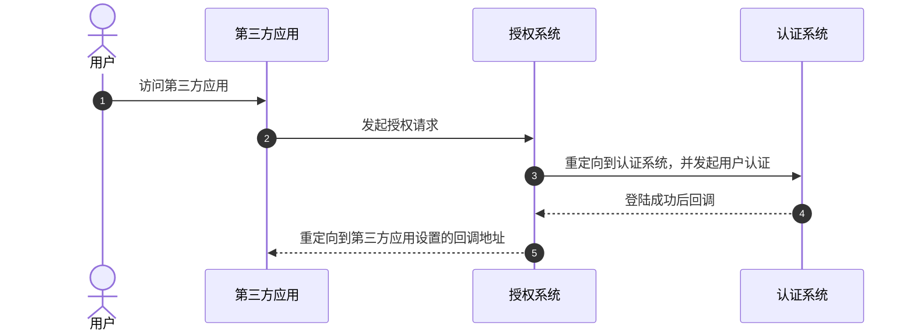
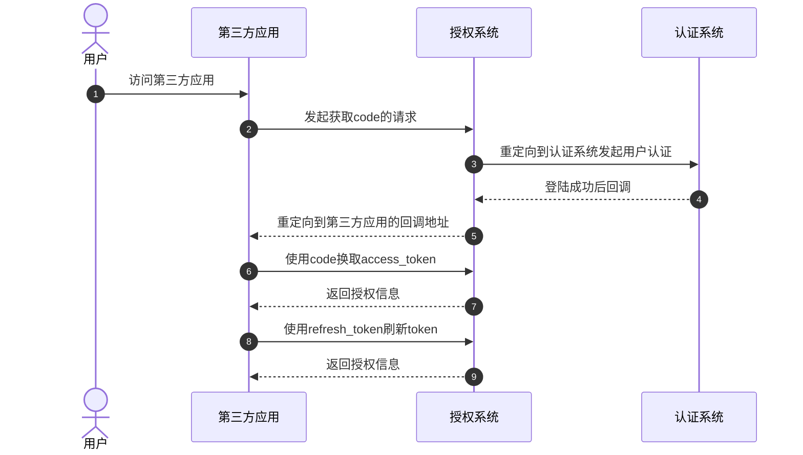
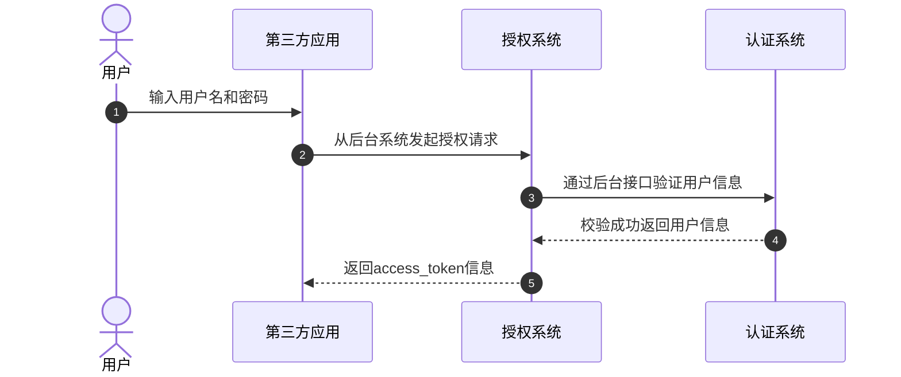
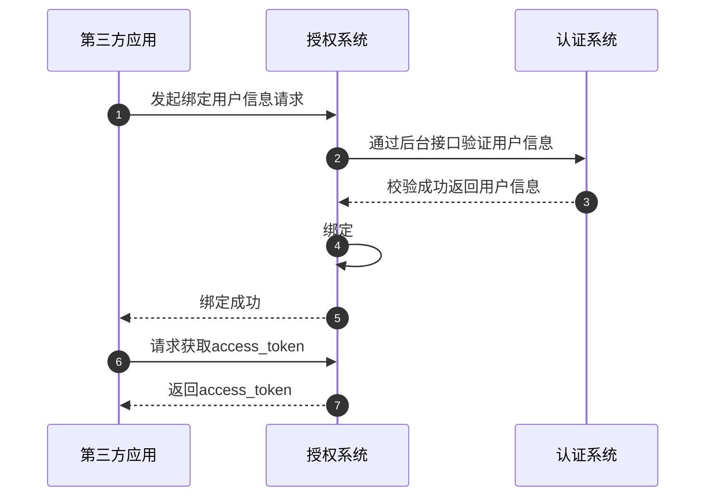

# OAuth 2 的四种授权模式

> 对应书中 **1.2 节**。本篇覆盖四种授权模式：**隐式、授权码、授信客户端密码、授信客户端（含变种）**。
>
> 一句话：**隐式模式**把令牌直接交给前端（不安全、已少用）；**授权码模式**先拿一次性 code，再由后端用 `code + client_secret` 换令牌（最常用、最稳妥）。

> [!note] 阅读约定
> 书中示例里的 `##` 代表一个参数占位符；`redirect_url` 在标准 OAuth 2 中写作 `redirect_uri`，含义相同，本文沿用书中写法以便对照。

## 本节导览

| 模式 | 令牌怎么到手 | 安全性 | 使用建议 |
| --- | --- | --- | --- |
| **隐式授权**（Implicit） | 回调 URL 里**直接带** `access_token` | 低 | 少用 |
| **授权码授权**（Authorization Code） | 先拿一次性 `code`，后端再换令牌 | 高 | **最广泛** |
| **授信客户端密码**（Password） | 第三方拿用户的账号密码直接换令牌 | 取决于第三方可信度 | 仅限高度信任方 |
| **授信客户端**（Client Credentials） | 应用用自己的 `client_id` / `client_secret` 换令牌 | 高（不暴露用户密码） | M2M、自研应用 |

## 一、隐式授权模式（Implicit Grant）

### 1. 它是什么

用户在登录页登录成功后，授权系统**直接把令牌回调到第三方应用的前端**（浏览器地址），第三方应用拿到令牌即可调用开放能力。

特点：**没有后端换令牌这一步**，令牌直接暴露在前端。

### 2. 授权请求

用户在第三方应用引导下，浏览器跳到授权地址：

```http
GET https://example.oauth.com/oauth2/authorize
  ?client_id=##
  &redirect_url=##
  &scope=##,##
  &response_type=token
```

*示例 1.1 隐式授权请求*

| 参数 | 含义 |
| --- | --- |
| `client_id` | 第三方应用在开放平台注册后拿到的唯一标识 |
| `redirect_url` | 第三方应用注册的回调地址 |
| `scope` | 访问权限，通常是用逗号分隔的多个字符串 |
| `response_type` | 隐式模式固定为 `token`，表示直接返回令牌 |

### 3. 回调（令牌直接出现在 URL）

用户登录成功后，授权系统重定向到回调地址，令牌作为 URL 参数返回：

```http
https://example.com/callback?access_token=ya29GAHES6zSzX&token_type=bearer&expires_in=3600
```

*示例 1.2 隐式授权回调*

| 参数 | 含义 |
| --- | --- |
| `access_token` | 访问令牌，代表用户调用已授权的开放接口 |
| `token_type` | 令牌类型，一般是 `bearer`；也可能出现 `PoP` 等类型（HTTPS 普及后基本不用） |
| `expires_in` | 过期时间，单位秒 |

> `bearer` 令牌就是一串字符串（十六进制串或 JWT）。谁拿到它，谁就能用——所以它**不能泄露**。

### 4. 交互流程

1. 用户访问第三方应用。
2. 第三方应用引导用户向授权系统发起授权请求（上面的请求示例）。
3. 授权系统做初步校验（`client_id` 是否存在、`redirect_url` 是否一致等），通过后跳转认证系统让用户登录。
4. 用户登录成功，认证系统回调授权系统；授权系统拿到用户信息、走完必要授权流程后生成 `access_token`。
5. 授权系统重定向到回调地址，令牌随 URL 返回（上面的回调示例）。



*图 1-1 隐式授权系统交互流程*


### 5. 为什么实际用得少

- **令牌暴露在前端**：回调时 `access_token` 直接出现在浏览器地址里，可能被日志、历史记录、截图泄露。
- **http 明文风险**：如果回调地址是普通 `http`，参数在传输中可能被拦截。
- **难以续期**：可能无法刷新令牌，过期后只能让用户重新授权。

> 结论：隐式模式安全性不高，实际应用不多。

## 二、授权码授权模式（Authorization Code Grant）

### 1. 它是什么

前期流程和隐式模式类似，但**不直接返回 `access_token`**，而是先返回一个**有效期短、只能用一次**的 `code`。

第三方应用拿到 `code` 后，在**程序后台**用 `code + client_id + client_secret` 发起 POST 请求，换取完整令牌。

> 关键差异：**令牌走后端通道**，不经过浏览器；`client_secret` 永远不暴露给前端。

### 2. 完整流程

#### 步骤 1：获取 code

```http
GET https://example.oauth.com/oauth2/authorize
  ?client_id=##
  &response_type=code
  &redirect_url=##
  &state=##
  &scope=##
```

*示例 1.3 授权码请求*

| 参数 | 含义 |
| --- | --- |
| `client_id` | 第三方应用唯一标识 |
| `response_type` | 授权码模式固定为 `code` |
| `redirect_url` | 回调地址 |
| `state` | 第三方应用自定义；授权系统回调时**原样带回**，常用于校验或幂等 |
| `scope` | 访问权限范围 |

#### 步骤 2：回调拿到 code

```http
https://example.com/callback?state=##&code=##
```

*示例 1.4 授权码回调*

| 参数 | 含义 |
| --- | --- |
| `state` | 步骤 1 传入的值，原样回传 |
| `code` | 本次请求的目标：用它去换 `access_token` |

#### 步骤 3：后端用 code 换令牌

第三方应用在后台发起 POST：

```http
POST https://example.oauth.com/oauth2/access_token
Content-Type: application/x-www-form-urlencoded

client_id=##&client_secret=##&code=##&grant_type=authorization_code
```

*示例 1.5 用 code 换取令牌*

| 参数 | 含义 |
| --- | --- |
| `client_id` | 第三方应用唯一标识 |
| `client_secret` | 第三方应用在平台注册后拿到的密码（**绝不能泄露**） |
| `code` | 步骤 2 拿到的授权码 |
| `grant_type` | 固定为 `authorization_code`，授权系统据此识别授权模式 |

#### 步骤 4：拿到授权信息

```json
{
  "access_token": "ACCESS_TOKEN",
  "expires_in": 86400,
  "refresh_token": "REFRESH_TOKEN",
  "refresh_expires_in": 864000,
  "open_id": "OPENID",
  "scope": "SCOPE",
  "token_type": "bearer"
}
```

*示例 1.6 授权信息*

| 字段 | 含义 |
| --- | --- |
| `access_token` | 访问令牌；带着它调用开放平台网关，获取数据或功能 |
| `expires_in` | 访问令牌有效期（秒） |
| `refresh_token` | 刷新令牌，用来给 `access_token` 续期 |
| `refresh_expires_in` | 刷新令牌的有效期（秒） |
| `open_id` | 用户在该开放平台下的唯一标识，用于第三方应用绑定用户 |
| `scope` | 本次授予的权限范围 |
| `token_type` | 令牌类型 |

#### 步骤 5：绑定用户 + 刷新令牌

- 第三方应用先用 `open_id` 把用户绑定到自己的系统；
- 再用 `refresh_token` 刷新 `access_token`：

```http
POST https://example.oauth.com/oauth2/refresh_token
Content-Type: application/x-www-form-urlencoded

client_id=##&client_secret=##&grant_type=refresh_token&refresh_token=##
```

*示例 1.7 刷新令牌*

| 参数 | 含义 |
| --- | --- |
| `grant_type` | 刷新时固定为 `refresh_token` |
| `refresh_token` | 步骤 4 拿到的刷新令牌 |

返回内容与步骤 4 类似，但具体策略因系统而异：可能返回新的 `access_token`，也可能继续沿用旧的。

### 3. 交互流程（完整生命周期）

1. 用户访问第三方应用。
2. 第三方应用引导用户向授权系统发起**获取 code** 的请求。
3. 授权系统初步校验（`client_id`、`redirect_url` 等），通过后跳转认证系统让用户登录。
4. 用户登录成功，认证系统回调授权系统；授权系统获取用户信息、走完授权流程后生成令牌。
5. 授权系统重定向到回调地址（带 `code`）。
6. 第三方应用在后台用 `code` 换取 `access_token`。
7. 授权系统返回完整授权信息（此后即可调用相关接口）。
8. 需要维持有效期时，用 `refresh_token` 刷新。
9. 授权系统返回新的授权信息。



*图 1-2 授权码授权模式系统交互流程*


### 4. 为什么它最常用

- **有效期灵活**：可通过刷新令牌延长访问期限。有效期越长，第三方负担越轻但安全性越低；越短则相反，可按业务权衡。
- **令牌不经过浏览器**：`access_token` 由后端通道获取；配合 HTTPS，可避免被拦截。
- **即使 code 暴露也安全**：`code` 会出现在浏览器 URL 中（步骤 2），但它**有效期短、只能用一次**，且必须配合 `client_secret`（只有第三方应用自己知道）才能换取令牌——因此别人拿到 code 也没用。

## 三、授信客户端密码模式（Password Credentials Grant）

> 别被名字误导：它指的是「第三方应用拿**用户的**账号密码去换令牌」，不是「应用自己的密码」。

### 1. 适用场景

用于**共享用户账号体系**的第三方应用。例如母公司和子公司各自开发的应用共用一套账号体系：用户在第三方应用里输入用户名、密码，第三方应用直接拿这组信息换授权。

### 2. 授权请求

```http
POST https://example.oauth.com/oauth2/access_token
Content-Type: application/x-www-form-urlencoded

client_id=##&client_secret=##&username=##&password=##&grant_type=password
```

*示例 1.8 授信客户端密码模式授权请求*

| 参数 | 含义 |
| --- | --- |
| `client_id` / `client_secret` | 第三方应用的标识与密码 |
| `username` / `password` | 用户的账号与密码 |
| `grant_type` | 固定为 `password` |

### 3. 交互流程

1. 用户访问第三方应用，输入用户名和密码。
2. 第三方应用从**后台**向授权系统发起授权请求。
3. 授权系统通过后台接口（通常是内部 RPC）验证用户信息。
4. 认证系统校验成功，返回用户信息。
5. 授权系统向第三方应用返回 `access_token`（结构与授权码模式相同，含 `refresh_token`）。



*图 1-3 授信客户端密码模式系统交互流程*


### 4. 风险与边界

- 用户的**账号密码直接交给了第三方应用**；
- 因此开放平台必须对该应用**完全信任**，且应用要有能力保障用户信息安全；
- 实际只用于信任的合作方（子公司、KA 客户等），**场景较少**。

## 四、授信客户端模式（Client Credentials Grant）

> 这一节有两种形态：**标准**（无用户参与）与**变种**（自研应用绑定用户）。

### 1. 标准授信客户端模式

第三方应用直接访问开放平台，**不需要用户授权**；只返回 `access_token`，且只能调用**与用户无关**的能力（如公开数据、公共 API）。

请求与变种相同：

```http
POST https://example.oauth.com/oauth2/access_token
Content-Type: application/x-www-form-urlencoded

client_id=##&client_secret=##&grant_type=client_credentials
```

*示例 1.9 授信客户端模式授权请求（标准）*

返回（示例 1.10，注意**没有** `refresh_token`）：

```json
{
  "access_token": "ACCESS_TOKEN",
  "expires_in": 86400,
  "scope": "SCOPE",
  "token_type": "bearer"
}
```

*示例 1.10 标准授信客户端模式授权信息*

### 2. 变种授信客户端模式（自研应用）

用于**自研应用**授权：应用传自己的 `client_id` / `client_secret`，获取创建应用时被赋予的全部权限。由于创建自研应用时一般会**绑定用户账号**，拿到的其实是**绑定账号的权限**。

`grant_type` 用 `self_credentials`：

```http
POST https://example.oauth.com/oauth2/access_token
Content-Type: application/x-www-form-urlencoded

client_id=##&client_secret=##&grant_type=self_credentials
```

*示例 1.9（变种）授信客户端模式授权请求*

返回结构与授权码模式相同（示例 1.6，含 `refresh_token`）。

### 3. 变种模式的交互流程

**A. 创建自研应用时绑定用户**

1. 第三方应用发起绑定用户信息请求。
2. 授权系统通过后台接口验证用户信息。
3. 认证系统校验成功，返回用户真实信息。
4. 授权系统把用户信息与应用信息绑定。
5. 授权系统返回绑定成功。

**B. 授权**

6. 第三方应用向授权系统请求 `access_token`（`grant_type=self_credentials`）。
7. 授权系统返回授权信息（同示例 1.6）。



*图 1-4 授信客户端模式系统交互流程*

### 4. 两种形态的区别

| 形态 | `grant_type` | 是否绑定用户 | 能访问什么 |
| --- | --- | --- | --- |
| 标准 | `client_credentials` | 否 | 与用户无关的开放能力 |
| 变种（自研应用） | `self_credentials` | 是（创建时绑定） | 绑定用户的数据与相关功能 |

## 五、四种模式对比

| 对比项 | 隐式授权 | 授权码授权 | 授信客户端密码 | 授信客户端 |
| --- | --- | --- | --- | --- |
| 用户是否参与 | 是 | 是 | 是（在第三方输入密码） | 标准：否；变种：事先绑定 |
| 是否用 `client_secret` | 否 | 是 | 是 | 是 |
| 令牌是否经过浏览器 | 是 | 否 | 否 | 否 |
| 是否把用户密码交给第三方 | 否 | 否 | **是** | 否 |
| 是否返回 `refresh_token` | 通常无 | 有 | 有 | 标准：无；变种：有 |
| 可访问范围 | 用户授权范围 | 用户授权范围 | 用户授权范围 | 标准：与用户无关；变种：绑定用户 |
| 安全性 | 低 | 高 | 取决于第三方可信度 | 高 |
| 典型场景 | 已少用 | 最广泛 | 母子公司 / KA 客户 | M2M / 自研应用 |

## 六、易混点小抄

- **`state` 是防伪标记**：授权系统原样回传，第三方应用据此校验回调是否来自自己发起的请求，也常用于幂等。
- **`code` 是一次性、短命的**：换了令牌就作废；即使泄露，没有 `client_secret` 也换不到令牌。
- **`client_secret` 只留在后端**：永远不要写进前端代码或 URL。
- **`access_token` 是通行证，`refresh_token` 是续期凭证**：前者短命，后者长命，刷新时可能轮换。
- **`open_id` 用来认人**：第三方应用用它把开放平台用户绑定到自己的账号体系。
- **密码模式的关键不是"密码"，是"信任"**：它把用户账号密码交给了第三方应用，所以只能给母子公司、KA 客户这类完全可信方用。
- **`client_credentials` ≠ `self_credentials`**：两者请求写法一样，靠 `grant_type` 区分；标准模式只能访问与用户无关的能力，变种模式因为绑定了用户，才能访问该用户的数据。
- **标准客户端模式通常没有 `refresh_token`**：只返回 `access_token`；变种模式则返回完整授权信息。

## 七、四种模式怎么选（书末总结）

| 模式 | 书中结论 |
| --- | --- |
| 隐式授权 | 存在安全问题，工作实践中应用较少 |
| 授权码授权 | 前后端通道分离，安全性强，**应用最广泛** |
| 授信客户端密码 | 会把密码直接暴露给第三方，要求对方安全措施良好且完全可信（如子公司），场景较少 |
| 授信客户端（标准） | 开放平台把**与用户无关**的功能开放给第三方应用 |
| 授信客户端（变种） | 已绑定用户，可获取**绑定用户**的数据与功能，一般用于**自研应用**授权 |

> 选型一句话：**有用户参与、要安全 → 授权码；无用户参与、机器对机器 → 客户端模式；高度信任且共享账号 → 密码模式；隐式尽量别用。**

## 相关

- [[30-后端开发/80-接口与协议/10-OAuth2/01-OAuth 2 的定义与核心角色|01-OAuth 2 的定义与核心角色]]
- [[30-后端开发/80-接口与协议/10-OAuth2/00-索引|10-OAuth2]]
- [[30-后端开发/80-接口与协议/00-索引|80-接口与协议]]
